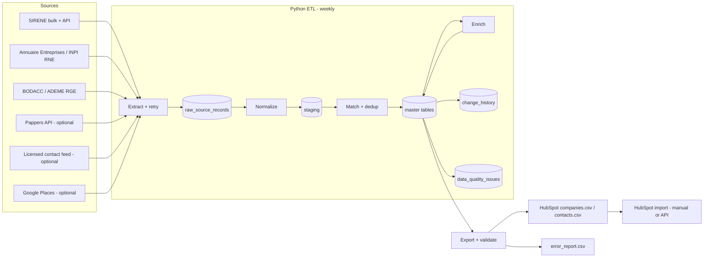

# 5. Architecture

## Data flow
1. Extract: download bulk stock (first run) or API delta (weekly), store raw payload.
2. Normalize: names, addresses, phones (E.164), emails, domains.
3. Match: SIREN/SIRET exact; fuzzy only for non-registry sources.
4. Merge: field-level resolution by priority, recency, confidence.
5. Diff: compare to previous master, write change history.
6. Export: HubSpot CSV, validate, write error report and weekly report.

## Stack
PostgreSQL 16, Python 3.11 (psycopg, pandas/polars, httpx, tenacity, rapidfuzz, phonenumbers, pydantic),
cron/systemd timer, Docker Compose, pytest, structlog.

## Storage estimate
| Layer | Approx size |
|---|---|
| SIRENE stock raw (establishments ~ 40M rows incl. closed) | 15-25 GB CSV |
| Master (1-3M active filtered + history) | 5-15 GB |
| Enrichment + raw API payloads | 5-20 GB |
| Indexes | +30-50% |
Plan 100 GB SSD for comfort; 8 vCPU / 32 GB RAM server.

## Scalability
Bulk load via COPY, partition raw table by source+month, batch upserts of 10-50k rows,
GIN trigram index only on columns used for fuzzy matching, enrichment calls queued and rate-limited.
