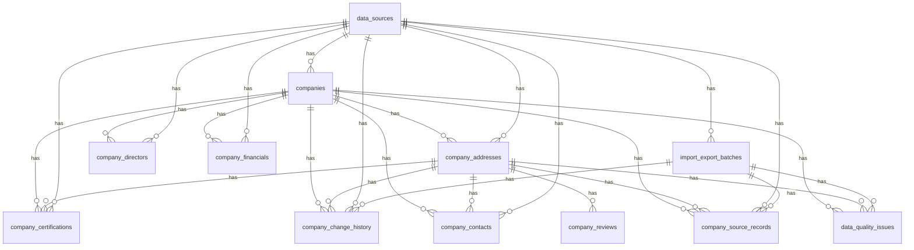

# 6. Detailed Relational Schema

DDL: `sql/000_reference_data.sql` (departments/regions, employee ranges, legal forms: lookup tables used by the export view), `sql/001_schema.sql` (core, 12 tables), `002_staging.sql`, `003_pipeline_state.sql`, `004_export_view.sql`, `005_directors_enrichment.sql`, `006_closure_date.sql` (upgrade only: adds `closure_date_basis` and the staging column to a database created before they existed; a no-op on a fresh install).
Column-by-column description (type, required/optional, meaning, example, validation) is in
[05-data-dictionary.md](05-data-dictionary.md). This document adds what the dictionary does not: keys, constraints, indexes and how
identifiers are handled. The constraint and index lists below are generated from the live PostgreSQL catalog
(`scripts/gen_schema_doc.py`), not retyped.

## The 12 required tables
| # | Table | Grain | Natural key |
|---|---|---|---|
| 1 | `companies` | one legal unit | `siren` (unique) |
| 2 | `company_addresses` | one **establishment** (address + local data) | `siret` (unique) |
| 3 | `company_contacts` | one phone / email / website / social value per company or establishment | (type, normalized value) |
| 4 | `company_directors` | one director per company | (company, last name, first name, role) |
| 5 | `company_financials` | one fiscal year per company | (company, fiscal year) |
| 6 | `company_certifications` | one certification per company | (company, type, number) |
| 7 | `company_reviews` | one provider rating per establishment | (establishment, provider) |
| 8 | `data_sources` | one source, with priority and licence notes | `code` |
| 9 | `company_source_records` | one raw/normalized payload per source and record | (source, source record id) |
| 10 | `company_change_history` | one changed field (old value, new value) | `change_id` |
| 11 | `import_export_batches` | one import / export / enrich run, with counters | `batch_id` |
| 12 | `data_quality_issues` | one open or resolved data problem | `issue_id` |

Support tables: `stg_sirene_ul`, `stg_sirene_etab` (COPY targets), `pipeline_state` (watermark), `naf_reference` (NAF label and trade).

## Identifiers: how the hard cases are handled
- **Company vs establishment.** SIREN identifies the legal unit (`companies`), SIRET (SIREN + 5-digit NIC) identifies one
  establishment (`company_addresses`). One company has 1..n establishments, all pointing to it through `company_addresses.company_id`.
  The head office is flagged `is_head_office`; the partial unique index `ux_one_head_office` allows at most one active head office per company.
- **Multiple establishments.** Each establishment is its own row with its own address, local NAF, phone, website and reviews. In HubSpot
  each active establishment becomes one company record (see [07-hubspot-mapping.md](07-hubspot-mapping.md)); `SIREN` groups them.
- **Sole proprietors.** Modelled as a company with `is_sole_proprietor = true` (the business is the person). They stay in the registry
  tables but are excluded from director enrichment and treated with extra GDPR caution.
- **Missing identifiers.** `siren` and `siret` are nullable with a format CHECK and a UNIQUE constraint (PostgreSQL allows many NULLs). Records from
  non-registry sources without a valid SIREN never enter `companies`: they stay in `company_source_records` and open a `data_quality_issues` row until matched.
- **Change of legal status.** `companies.status` (`active`, `closed`, `dissolved`, `other`) and `legal_form_code` are tracked in
  `company_change_history` (old and new value, `change_type` `update` / `close` / `reopen`). The row is never deleted, so a re-opened unit keeps its history.
- **Establishment moves.** SIRENE normally attributes a new SIRET when an establishment moves to another commune. The pipeline sees this as the
  old SIRET closing and a new SIRET inserted (two history rows). Linking them through INSEE's succession file is not implemented yet.
- **Non-diffusible units** (`is_diffusible = false`) are loaded for change tracking but never exported.

## Constraints and indexes per table (generated from the PostgreSQL catalog)

### companies

27 columns.

- **Check**: `CHECK (((confidence_score >= (0)::numeric) AND (confidence_score <= (1)::numeric)))`
- **Check**: `CHECK ((dup_status = ANY (ARRAY['unique'::text, 'merged'::text, 'review'::text])))`
- **Check**: `CHECK ((main_naf ~ '^[0-9]{2}\.[0-9]{2}[A-Z]$'::text))`
- **Check**: `CHECK ((siren ~ '^[0-9]{9}$'::text))`
- **Check**: `CHECK ((status = ANY (ARRAY['active'::text, 'closed'::text, 'dissolved'::text, 'other'::text])))`
- **Foreign key**: `FOREIGN KEY (primary_source_id) REFERENCES data_sources(source_id)`
- **Primary key**: `PRIMARY KEY (company_id)`
- **Unique**: `UNIQUE (siren)`
- **Index** `ix_companies_directors_checked`: `companies USING btree (directors_checked_at NULLS FIRST)`
- **Index** `ix_companies_naf`: `companies USING btree (main_naf)`
- **Index** `ix_companies_name_trgm`: `companies USING gin (legal_name gin_trgm_ops)`
- **Index** `ix_companies_status`: `companies USING btree (status)`

### company_addresses

25 columns.

- **Check**: `CHECK ((address_status = ANY (ARRAY['verified'::text, 'sourced'::text, 'unverified'::text, 'invalid'::text])))`
- **Check**: `CHECK (((postal_code IS NULL) OR (postal_code ~ '^[0-9]{2}[0-9AB][0-9]{2}$'::text)))`
- **Check**: `CHECK ((siret ~ '^[0-9]{14}$'::text))`
- **Check**: `CHECK ((status = ANY (ARRAY['active'::text, 'closed'::text, 'other'::text])))`
- **Foreign key**: `FOREIGN KEY (company_id) REFERENCES companies(company_id) ON DELETE CASCADE`
- **Foreign key**: `FOREIGN KEY (source_id) REFERENCES data_sources(source_id)`
- **Primary key**: `PRIMARY KEY (establishment_id)`
- **Unique**: `UNIQUE (siret)`
- **Index** `ix_addr_company`: `company_addresses USING btree (company_id)`
- **Index** `ix_addr_dept`: `company_addresses USING btree (department_code)`
- **Index** `ix_addr_hash`: `company_addresses USING btree (address_hash)`
- **Index** `ix_addr_postal`: `company_addresses USING btree (postal_code)`
- **Index** `ux_one_head_office`: `company_addresses USING btree (company_id) WHERE (is_head_office AND (status = 'active'::text))`

### company_contacts

11 columns.

- **Check**: `CHECK ((contact_type = ANY (ARRAY['phone'::text, 'email'::text, 'website'::text, 'linkedin'::text, 'social'::text])))`
- **Check**: `CHECK ((value_status = ANY (ARRAY['verified'::text, 'sourced'::text, 'inferred'::text, 'unavailable'::text])))`
- **Foreign key**: `FOREIGN KEY (company_id) REFERENCES companies(company_id) ON DELETE CASCADE`
- **Foreign key**: `FOREIGN KEY (establishment_id) REFERENCES company_addresses(establishment_id) ON DELETE CASCADE`
- **Foreign key**: `FOREIGN KEY (source_id) REFERENCES data_sources(source_id)`
- **Primary key**: `PRIMARY KEY (contact_id)`
- **Unique**: `UNIQUE (company_id, contact_type, value_normalized)`
- **Index** `ix_contacts_norm`: `company_contacts USING btree (contact_type, value_normalized)`

### company_directors

11 columns.

- **Foreign key**: `FOREIGN KEY (company_id) REFERENCES companies(company_id) ON DELETE CASCADE`
- **Foreign key**: `FOREIGN KEY (source_id) REFERENCES data_sources(source_id)`
- **Primary key**: `PRIMARY KEY (director_id)`
- **Unique**: `UNIQUE (company_id, last_name, first_name, role)`
- **Index** `ix_directors_company`: `company_directors USING btree (company_id)`

### company_financials

8 columns.

- **Check**: `CHECK (((fiscal_year >= 1990) AND (fiscal_year <= 2100)))`
- **Foreign key**: `FOREIGN KEY (company_id) REFERENCES companies(company_id) ON DELETE CASCADE`
- **Foreign key**: `FOREIGN KEY (source_id) REFERENCES data_sources(source_id)`
- **Primary key**: `PRIMARY KEY (financial_id)`
- **Unique**: `UNIQUE (company_id, fiscal_year, source_id)`

### company_certifications

9 columns.

- **Foreign key**: `FOREIGN KEY (company_id) REFERENCES companies(company_id) ON DELETE CASCADE`
- **Foreign key**: `FOREIGN KEY (establishment_id) REFERENCES company_addresses(establishment_id)`
- **Foreign key**: `FOREIGN KEY (source_id) REFERENCES data_sources(source_id)`
- **Primary key**: `PRIMARY KEY (certification_id)`
- **Unique**: `UNIQUE (company_id, cert_type, cert_label, valid_from)`

### company_reviews

9 columns.

- **Check**: `CHECK (((rating >= (0)::numeric) AND (rating <= (5)::numeric)))`
- **Foreign key**: `FOREIGN KEY (establishment_id) REFERENCES company_addresses(establishment_id) ON DELETE CASCADE`
- **Primary key**: `PRIMARY KEY (review_id)`
- **Unique**: `UNIQUE (establishment_id, provider)`

### data_sources

7 columns.

- **Primary key**: `PRIMARY KEY (source_id)`
- **Unique**: `UNIQUE (code)`

### company_source_records

10 columns.

- **Check**: `CHECK ((match_status = ANY (ARRAY['matched'::text, 'new'::text, 'review'::text, 'rejected'::text])))`
- **Foreign key**: `FOREIGN KEY (batch_id) REFERENCES import_export_batches(batch_id)`
- **Foreign key**: `FOREIGN KEY (company_id) REFERENCES companies(company_id)`
- **Foreign key**: `FOREIGN KEY (establishment_id) REFERENCES company_addresses(establishment_id)`
- **Foreign key**: `FOREIGN KEY (source_id) REFERENCES data_sources(source_id)`
- **Primary key**: `PRIMARY KEY (record_id)`
- **Unique**: `UNIQUE (source_id, external_key, payload_hash)`
- **Index** `ix_srcrec_company`: `company_source_records USING btree (company_id)`

### company_change_history

11 columns.

- **Check**: `CHECK ((change_type = ANY (ARRAY['insert'::text, 'update'::text, 'close'::text, 'reopen'::text, 'delete'::text])))`
- **Foreign key**: `FOREIGN KEY (batch_id) REFERENCES import_export_batches(batch_id)`
- **Foreign key**: `FOREIGN KEY (company_id) REFERENCES companies(company_id) ON DELETE CASCADE`
- **Foreign key**: `FOREIGN KEY (establishment_id) REFERENCES company_addresses(establishment_id)`
- **Foreign key**: `FOREIGN KEY (source_id) REFERENCES data_sources(source_id)`
- **Primary key**: `PRIMARY KEY (change_id)`
- **Index** `ix_change_batch`: `company_change_history USING btree (batch_id)`
- **Index** `ix_change_company`: `company_change_history USING btree (company_id, changed_at DESC)`

### import_export_batches

13 columns.

- **Check**: `CHECK ((batch_type = ANY (ARRAY['import'::text, 'export'::text, 'enrich'::text])))`
- **Check**: `CHECK ((status = ANY (ARRAY['running'::text, 'success'::text, 'partial'::text, 'failed'::text])))`
- **Foreign key**: `FOREIGN KEY (source_id) REFERENCES data_sources(source_id)`
- **Primary key**: `PRIMARY KEY (batch_id)`

### data_quality_issues

11 columns.

- **Check**: `CHECK ((severity = ANY (ARRAY['info'::text, 'warning'::text, 'error'::text])))`
- **Check**: `CHECK ((status = ANY (ARRAY['open'::text, 'resolved'::text, 'ignored'::text])))`
- **Foreign key**: `FOREIGN KEY (batch_id) REFERENCES import_export_batches(batch_id)`
- **Foreign key**: `FOREIGN KEY (company_id) REFERENCES companies(company_id) ON DELETE CASCADE`
- **Foreign key**: `FOREIGN KEY (establishment_id) REFERENCES company_addresses(establishment_id)`
- **Primary key**: `PRIMARY KEY (issue_id)`
- **Index** `ix_dqi_open`: `data_quality_issues USING btree (status, issue_code)`

### stg_sirene_ul

12 columns.

- **Primary key**: `PRIMARY KEY (siren)`

### stg_sirene_etab

16 columns.

- **Primary key**: `PRIMARY KEY (siret)`
- **Index** `ix_stg_etab_siren`: `stg_sirene_etab USING btree (siren)`

### pipeline_state

3 columns.

- **Primary key**: `PRIMARY KEY (key)`

### naf_reference

4 columns.

- **Check**: `CHECK ((naf ~ '^[0-9]{2}\.[0-9]{2}[A-Z]$'::text))`
- **Primary key**: `PRIMARY KEY (naf)`

## Entity relationships (generated from foreign keys)

