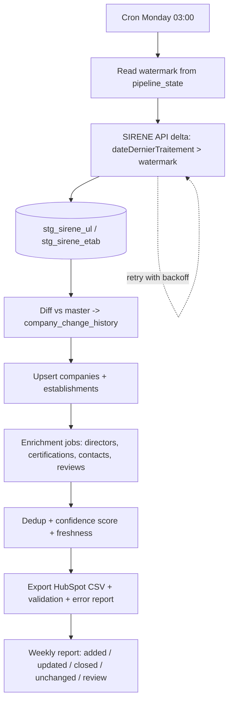

# 9. Weekly ETL Workflow

## Which sources support increments
| Source | Incremental? | Method |
|---|---|---|
| SIRENE API 3.11 | Yes | Query on `dateDernierTraitementEtablissement` / `...UniteLegale` greater than stored watermark, cursor pagination. Returns units whose distributed fields may be unchanged, so the diff step filters them |
| SIRENE bulk | No (monthly full stock) | Use for first load and a periodic (monthly/quarterly) full reconciliation to catch anything the delta missed |
| INPI RNE | Partly (daily stock / API by date) | Directors refreshed for companies touched in the delta, plus a rolling full refresh |
| BODACC | Yes | By publication date |
| ADEME RGE | No | Monthly full pull, diff on SIRET |
| Pappers / licensed feeds | Per-record lookups | Refresh only changed or stale records, within credit budget |
| Google Places | No | Refresh on demand, oldest first, within budget and ToS |

## Rules
- **Idempotent**: re-running a week yields no new history rows (diff finds nothing).
- **Closures**: establishment/company `status` change to `closed` writes a `close` history row and drops the record from the next HubSpot export (flagged for HubSpot update, not deleted).
- **Closure date**: if the SIRENE API period began with the change of administrative state, its start date is stored as the exact closure date (`closure_date_basis = 'insee'`). Otherwise the weekly run stores the date INSEE processed the change and marks it `observed`; bulk-loaded closed units keep it empty. A reopened unit has the date cleared.
- **Changes logged**: street, postal code, city, NAF, name, head-office flag, status, legal form, headcount band.
- **Retries**: exponential backoff (2 s to 120 s, 6 attempts) on HTTP 429/5xx and network errors; a failed batch is marked `failed` in `import_export_batches`, rolled back, and the watermark is not advanced.
- **Weekly report** (`reports/weekly_YYYY-MM-DD.md`): read, added, updated, closed, unchanged, review.
- **Director changes** are implemented in `fbdb.enrich.directors` (run by `scripts/run_weekly.sh` after the SIRENE delta): current directors come from the Annuaire des Entreprises API, additions and departures are written to `company_change_history` (`insert` / `delete`, old and new value) and the run is logged in `import_export_batches` (`batch_type = 'enrich'`). Each run checks at most `--limit` companies (never-checked first, then oldest), and re-checks a company after `--refresh-days` (default 30), so the weekly load stays bounded.
- **Phone/email changes** depend on a licensed contact feed: the loader (`fbdb.enrich.licensed_contacts`) is built and records new values in the same history table, but no provider is selected or contracted yet.

## Operating requirements
- Typical delta: ~100k-300k changed establishments/week (to be measured on real data); diff + upsert should take minutes on PostgreSQL, the API fetch dominates (1,000 rows per call, subject to INSEE quota).
- Full monthly reconciliation: bulk file reload into staging + diff, roughly 1-3 hours on 8 vCPU / 32 GB.
- Alerting: non-zero exit code from `scripts/run_weekly.sh`; wire to email/Slack.

## Ongoing costs (to confirm with real quotes)
| Item | Estimate |
|---|---|
| SIRENE API + open data | Free (INSEE quota applies) |
| Server (8 vCPU/32 GB/100 GB) | ~EUR 60-150 / month |
| Pappers / licensed contacts / Google Places | Variable, usage- and contract-based: the main cost driver, quote before committing |
| Maintenance (monitoring, schema/API drift, fixes) | ~0.5-1 day / month |
